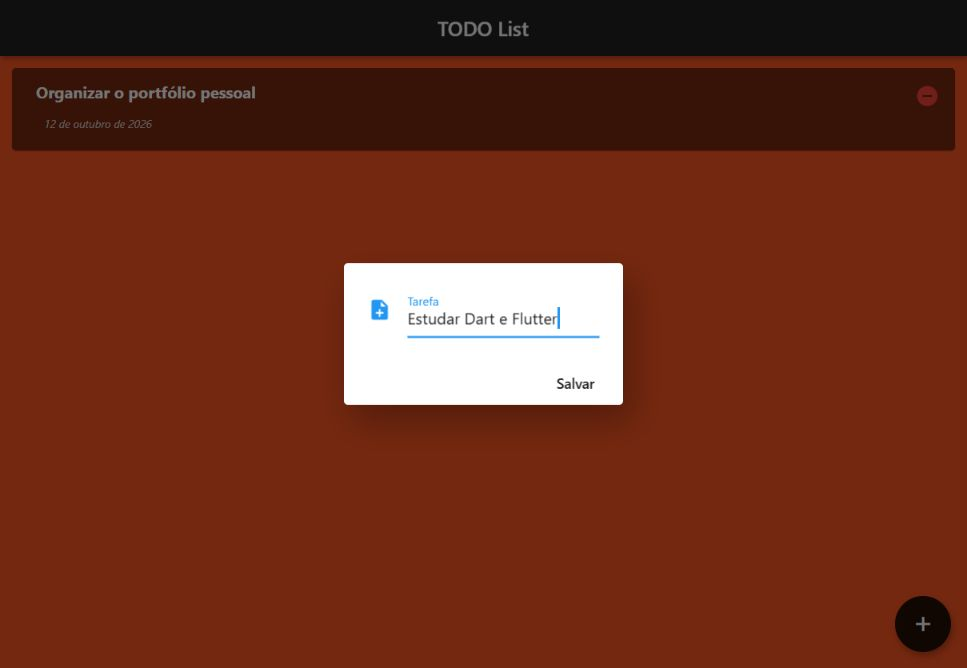
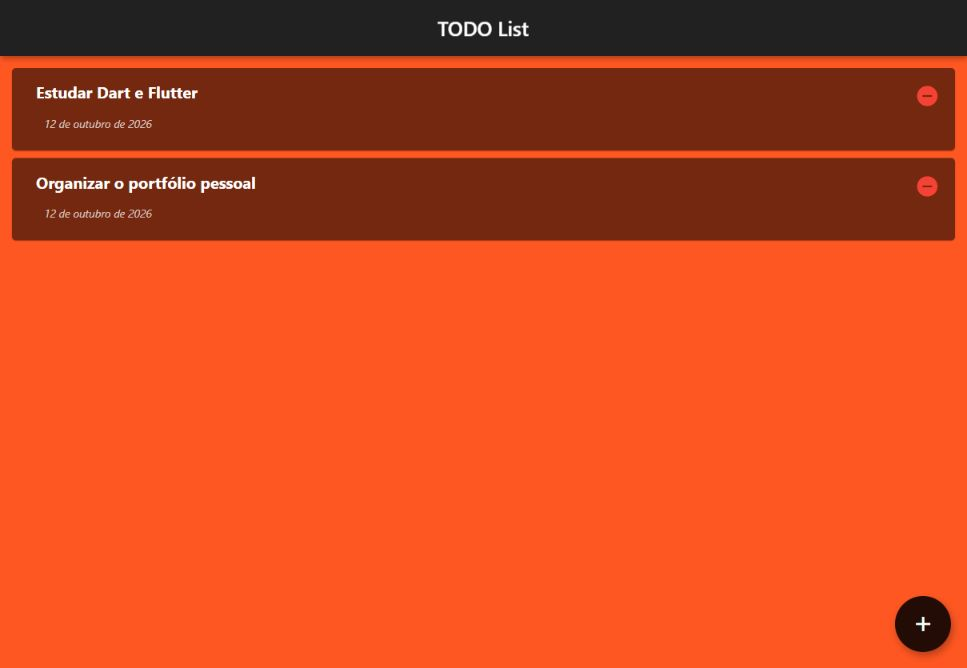

# Lista de Afazeres em Flutter

Aplicativo móvel para anotar tarefas e manter a lista no dispositivo. O projeto combina uma interface em Flutter com persistência em SQLite, incluindo cadastro, consulta, edição e exclusão de afazeres.

**Categoria:** Frontend · Aplicativo móvel · Persistência local.

## Tecnologias principais

- Dart 2
- Flutter
- SQLite com sqflite

## Funcionalidades

- Abrir um formulário pelo botão de adicionar tarefa.
- Salvar o nome do afazer e sua data no banco local.
- Carregar os registros ao abrir o aplicativo.
- Exibir cartões com o nome e a data formatada em português.
- Abrir a edição mantendo o item pressionado.
- Remover um item pelo ícone na lista.

## Como os dados são organizados

O modelo `Afazer` converte os objetos entre Dart e os registros do banco. A classe `DbAjudante` centraliza as operações SQLite. A tabela `afazeresTabela` contém os campos `id`, `nome`, `data` e `finalizar`. A presença do campo `finalizar` não implica que a interface tenha um fluxo completo de conclusão de tarefas.

| Caminho | Responsabilidade |
| --- | --- |
| `lib/model/afazer.dart` | Modelo e conversão dos registros. |
| `lib/util/db_ajudante.dart` | Criação e operações do banco SQLite. |
| `lib/view/afazeres_tela.dart` | Lista, formulário e ações sobre os afazeres. |

## Executar

O aplicativo original utiliza plugins móveis, especialmente `sqflite` e `path_provider`. Configure um dispositivo ou emulador Android/iOS e use Flutter com Dart 2:

```bash
flutter pub get
flutter run --no-sound-null-safety
```

O projeto usa dependências antigas, incluindo `path_provider 0.4.x` e `intl 0.15.x`. A execução em SDKs atuais requer uma atualização de compatibilidade. A implementação original do banco não está preparada para Flutter Web.

## Execução das capturas

Para capturar a interface no navegador, foi gerado um destino web com Flutter 2.10.5. Somente na cópia local, `DbAjudante` foi ligado a uma ponte HTTP que grava em um banco SQLite real. Foram cadastrados dois afazeres e um registro foi recarregado após atualizar a página.

Essa adaptação preserva a interface, mas não representa suporte web nativo do repositório. A ponte e a troca da classe de banco não fazem parte desta atualização de documentação. Edição e exclusão não foram verificadas durante a coleta das imagens.

## Relação com outros projetos

Aplicativo independente, com banco local. Não é o frontend de `todo-list-v2`, que é outro gerenciador de tarefas desenvolvido em Java.

## Capturas do sistema

Capturas reais obtidas em execução local em 12/10/2026.

### Página inicial


### Cadastro de uma tarefa



### Afazeres persistidos em SQLite



## Histórico

Repositório criado no GitHub em **2021-03-05**. Essa data identifica a criação do repositório; não comprova o início nem a conclusão do desenvolvimento.
